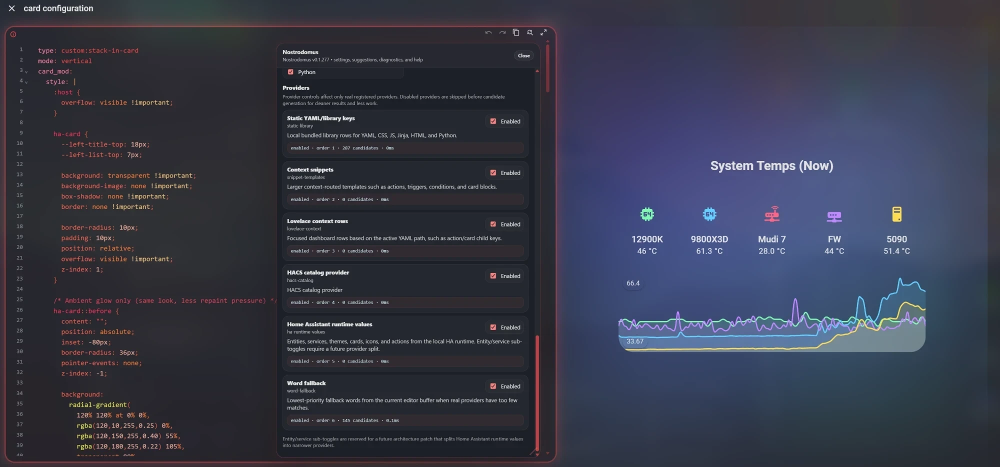
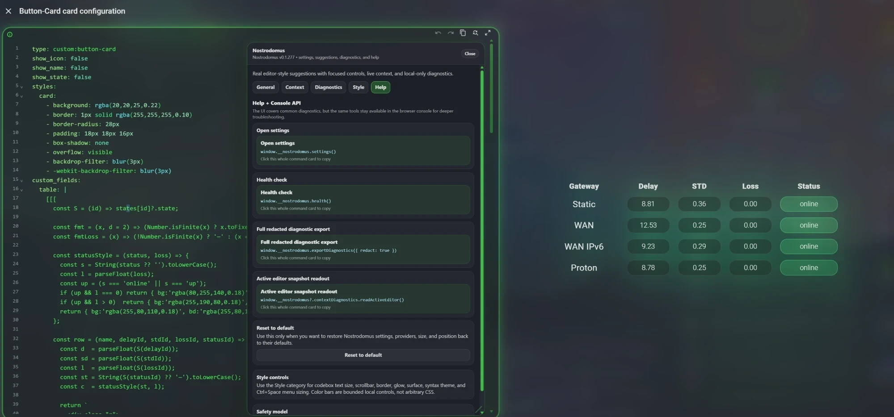
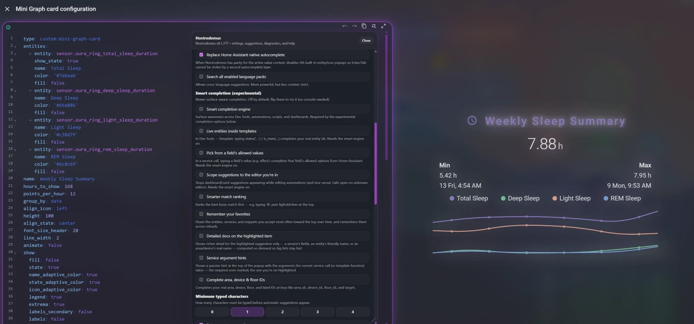
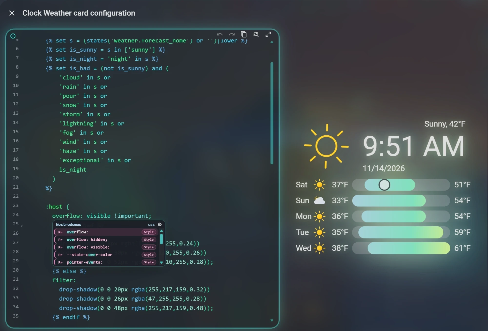

# Nostrodomus

[](https://github.com/Views2k/nostrodomus/actions/workflows/ci.yml)
[](https://github.com/Views2k/nostrodomus/blob/main/LICENSE)
[](https://www.home-assistant.io/)
[-orange.svg)](https://github.com/Views2k/nostrodomus/blob/main/docs/KNOWN_ISSUES.md)

[](https://github.com/Views2k/nostrodomus/blob/main/DOCUMENTATION.md)

Context-aware autocomplete, snippets, and syntax styling for Home Assistant's card and YAML editors.

Nostrodomus adds autocomplete, snippets, and syntax coloring to the code editors you already use in Home Assistant: the dashboard card editor, `card_mod` blocks, and YAML configuration. Suggestions come from your own running instance or a bundled catalog. It makes no network calls.

It is beta (`0.1.x`), but stable and in daily use. Current limitations are listed in [Known issues](docs/KNOWN_ISSUES.md). There is no YAML to configure.

<table>
  <tr>
    <td></td>
    <td></td>
  </tr>
  <tr>
    <td></td>
    <td></td>
  </tr>
</table>

The card editor with four different frame colors and syntax themes, each with the settings panel open on another tab. The dashboard behind the dialog, and its wallpaper, are the author's own; the dialog shows your dashboard.

## Requirements

| | |
|---|---|
| Home Assistant | 2026.6.0 or newer |
| Installer | The Marketplace built into Home Assistant 2026.11 and later, HACS 2.0.0 or later on earlier versions, or manual resource registration |
| Browser | A Chromium-based browser (Chrome, Edge, Brave and others). Firefox is not supported yet, and Safari is not tested; see [Known issues](docs/KNOWN_ISSUES.md) |
| Where it works | The dashboard card-edit dialog, `card_mod` style blocks, the dashboard raw configuration editor, the automation and script YAML editors, and the template editor of Developer Tools |

Home Assistant's built-in dashboards (Overview, Lights, Security, and so on) do not load custom frontend resources, so Nostrodomus starts once a dashboard you created has been opened in the browser tab.

## Features

### Context-aware autocomplete
Suggestions follow your cursor. Nostrodomus reads the surrounding YAML to know whether you are typing a card type, an action, a service call, an entity id, or a `card_mod` style block, and offers completions that fit that spot. That includes live entity suggestions (`sensor.*`, `light.*`, and so on) pulled from your own instance, even inside options for custom cards it does not know about. Press `Ctrl+Space` to open or close suggestions at any time; while the list is open it follows what you type. To have the list open by itself as you type, turn on "Keep Nostrodomus armed" in the General tab of the settings panel (off by default).



The list knows which language the cursor is in. Here it is inside a `card_mod` style block, between two Jinja blocks: typing `overflow` lists the CSS property, its common values and the other properties that match, and the header shows the language the list was built for.

### Instance-aware card completion
`type:` completion uses both Home Assistant's live registry and a catalog of common Lovelace and HACS cards (mini-graph, ApexCharts, Mushroom, button-card, and others). `custom:` completions show up for cards you already have installed and for ones you have not installed yet, each with its readable name.

### Service field completion
Action blocks complete like a form. Once you pick a service (`service: light.turn_on`, `perform_action:`, or a modern automation `action:` step), Nostrodomus reads that service's schema from your instance and offers its real data fields under `data:` (`transition`, `brightness_pct`, `rgb_color`, and so on) with type and description, and marks required and advanced fields. For `target:` and `entity_id:`, entities in the matching domain come first. All of this is read from your running Home Assistant.

### Snippets
A validated set of snippets for the things you build often: dashboard cards, tap and hold actions, triggers, conditions, action sequences, targets, and `card_mod` styling. Snippets expand with tab-through placeholders, so you jump straight to the parts that need your values.

### Syntax styling
YAML, Jinja templates, CSS inside `card_mod`, and embedded JSON each get their own coloring in the same document. Colors are applied per token, so one line can mix YAML, a template and CSS. There are 37 syntax themes: a VS Code Dark+ "Classic" default, a range of color-named palettes, and two light themes. Keywords, strings, numbers, booleans, operators, and comments stay distinct. The editor box itself gets a frame you can configure (border, glow, frosted surface, scrollbar). The card editor dialog is translucent, with the dashboard softened behind it; this is the "Glass editor dialog" setting in the Style tab, which is on by default and can be turned off on slow computers. The styling is limited to the active editor and the card editor dialog it sits in, and nothing else on the dashboard is styled.

### Editor dialog
In the card editor dialog Nostrodomus enlarges the dialog to most of the window, with the editor and the card preview side by side, and fits the code editor to the space above the Save and Cancel row at every window size. In a window narrower than 1000 pixels, where Home Assistant puts the preview under the editor, the dialog scrolls instead. The dialog takes this size once its code editor has been shown.

### Visual editors
Nostrodomus works on Home Assistant's code editors. The visual editor that a custom card brings with it stays as the card built it, so a card can still be set up without writing YAML: its fields, toggles, buttons, expandable sections and notes are not changed, a code box inside it keeps its size, its look and the suggestions the card turned on, and the dialog stays the way Home Assistant drew it until you switch to the code editor. This goes by where an element sits in the dialog, not by a list of cards, so it holds for every custom card.

### Settings panel
A draggable, keyboard-operable settings panel opens inside the editor dialog, split into five tabs: General, Context, Diagnostics, Style, and Help. Ordinary changes apply in place, and the panel keeps its position, tab, and scroll while you adjust.

## Installation

### Marketplace or HACS
From Home Assistant 2026.11, HACS is built in as the Marketplace (Settings, Marketplace). On earlier versions, use HACS 2.0 or later.

1. Search for Nostrodomus. If it is not listed, open the three-dot menu, choose Custom repositories, and add `https://github.com/Views2k/nostrodomus` with the type Dashboard. The Marketplace asks you to connect GitHub before it adds a custom repository.
2. Install Nostrodomus. On dashboards managed in the UI, the resource is registered for you.
3. Reload the browser without its cache. If Home Assistant asks for a restart, restart it once.

If you installed Nostrodomus by hand before, first delete the `/local/nostrodomus.js` resource and the `nostrodomus.js` file in `www`, so that only one copy loads.

If your dashboard resources are defined in YAML, add the installed file yourself and raise the `v` number after each update:

```yaml
lovelace:
  resource_mode: yaml
  resources:
    - url: /local/community/nostrodomus/nostrodomus.js?v=1
      type: module
```

With HACS on Home Assistant before 2026.11, the URL is `/hacsfiles/nostrodomus/nostrodomus.js?v=1`.

### Manual resource registration
1. Download `nostrodomus.js` from the [latest release](https://github.com/Views2k/nostrodomus/releases/latest) and copy it into your Home Assistant `www` folder, for example `/config/www/nostrodomus.js`. If the `www` folder did not exist before, restart Home Assistant once so that it serves the folder.
2. Go to Settings, Dashboards, the three-dot menu, Resources, and add:
   - URL: `/local/nostrodomus.js`
   - Type: JavaScript module
3. Hard-reload your browser. After you replace the file with a newer version, change the resource URL to `/local/nostrodomus.js?v=2` (and so on) so that browsers load the new copy.

To configure it, open the code editor of any card, press `Ctrl+Space`, and click the gear in the header of the suggestion list (or press `Ctrl+,`). Settings are stored in your browser's local storage, so there is no YAML setup.

## Privacy and security

Nostrodomus is a local-only frontend plugin. It makes no network requests. The shipped bundle contains no `fetch`, `XMLHttpRequest`, `WebSocket`, `sendBeacon`, telemetry, or remote-code path, and the build's verification gate enforces that. Every suggestion is derived from your running Home Assistant (its live registry and service schemas, read in the browser) or from a catalog bundled inside the plugin. Nothing about your instance, your dashboards, or your usage is sent anywhere. It renders only through safe DOM APIs (no `innerHTML`, no `eval`), and its styling is limited to the active editor and the card editor dialog it sits in, not the wider dashboard. Settings live in your browser's local storage.

Security policy and reporting: [SECURITY.md](SECURITY.md).

## Documentation

The full reference covers every setting, the keyboard-shortcut tables, all five tabs, the provider and context model, the 37 themes and style controls, worked examples, the `window.__nostrodomus` diagnostics API, and troubleshooting. It is in [DOCUMENTATION.md](DOCUMENTATION.md).

Quick links:
- [Keyboard shortcuts](DOCUMENTATION.md#keyboard-shortcuts)
- [Settings reference](DOCUMENTATION.md#settings-reference)
- [Examples](DOCUMENTATION.md#examples)
- [Diagnostics and the window.__nostrodomus API](DOCUMENTATION.md#diagnostics-and-the-api)
- [Troubleshooting](DOCUMENTATION.md#troubleshooting)
- [Known issues](docs/KNOWN_ISSUES.md)
- [Changelog](CHANGELOG.md)

## Troubleshooting (quick)

- No suggestions appear: make sure the editor has focus and press `Ctrl+Space`. Check the Diagnostics tab for provider status.
- Health check: run `window.__nostrodomus.health()` in the browser console. `ok: true` means the runtime is healthy.
- Stale version after an update: hard-reload the browser or bump the resource URL cache string. The running version is shown in the Diagnostics tab.
- Styling looks off with a custom theme: adjust or reset the frame controls in the Style tab. Styling is limited to the active editor and the card editor dialog it sits in.

More in [DOCUMENTATION.md, Troubleshooting](DOCUMENTATION.md#troubleshooting).

## Contributing

Bug reports and pull requests are welcome. See [CONTRIBUTING.md](CONTRIBUTING.md) for the build, test, and verification workflow, and `docs/` for architecture and contract references. When you report a bug, include a redacted diagnostics report (`window.__nostrodomus.exportDiagnostics()` or the Copy full report button in the Diagnostics tab). Do not paste secrets, tokens, full YAML, or private URLs.

## License

[MIT](LICENSE), 2026 Nostrodomus contributors.
