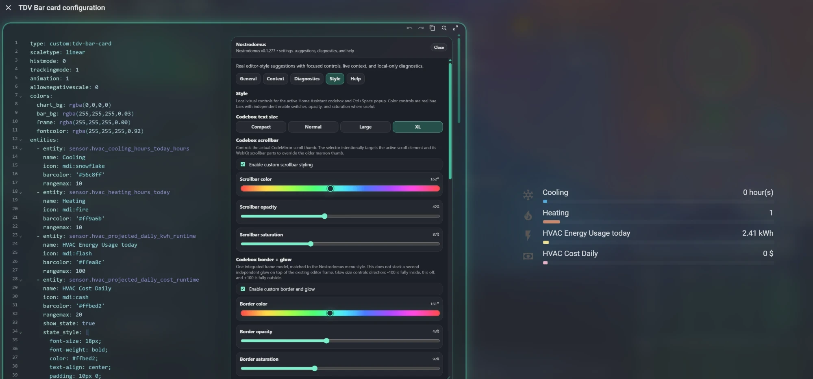

# Nostrodomus

[-orange.svg)](docs/KNOWN_ISSUES.md)

Context-aware autocomplete, snippets, and syntax styling for Home Assistant's card and YAML editors.

Nostrodomus adds autocomplete, snippets, and syntax coloring to the code editors you already use in Home Assistant: the dashboard card editor, `card_mod` blocks, and YAML configuration. Suggestions come from your own running instance or a bundled catalog. It makes no network calls.

It is beta (`0.1.x`), but stable and in daily use. Current limitations are listed in [Known issues](docs/KNOWN_ISSUES.md). There is no YAML to configure and no Home Assistant restart needed.

<table>
  <tr>
    <td></td>
    <td></td>
  </tr>
  <tr>
    <td></td>
    <td></td>
  </tr>
</table>

The card editor with four different frame colors and syntax themes, each with the settings panel open on another tab.

## Requirements

| | |
|---|---|
| Home Assistant | 2026.6.0 or newer |
| HACS | 2.0.0+ (recommended install path), or manual resource registration |
| Where it works | Any Home Assistant code editor: the dashboard card-edit dialog, `card_mod` style blocks, and YAML config, automation, script, and Developer Tools panels |

Home Assistant's built-in 2026.6 dashboards (Overview, Lights, Security, and so on) do not load custom frontend resources, so Nostrodomus starts once you open a code editor on a custom dashboard or a YAML editor.

## Features

### Context-aware autocomplete
Suggestions follow your cursor. Nostrodomus reads the surrounding YAML to know whether you are typing a card type, an action, a service call, an entity id, or a `card_mod` style block, and offers completions that fit that spot. That includes live entity suggestions (`sensor.*`, `light.*`, and so on) pulled from your own instance, even inside options for custom cards it does not know about. Press `Ctrl+Space` to open or close suggestions at any time; while the list is open it follows what you type. To have the list open by itself as you type, turn on "Keep Nostrodomus armed" in the General tab of the settings panel (off by default).

The list knows which language the cursor is in. Here it is inside a `card_mod` style block, between two Jinja blocks: typing `overflow` lists the CSS property, its common values and the other properties that match, and the header shows the language the list was built for.

### Instance-aware card completion
`type:` completion uses both Home Assistant's live registry and a catalog of common Lovelace and HACS cards (mini-graph, ApexCharts, Mushroom, button-card, and others). `custom:` completions show up for cards you already have installed and for ones you have not installed yet, each with its readable name.

### Service field completion
Action blocks complete like a form. Once you pick a service (`service: light.turn_on`, `perform_action:`, or a modern automation `action:` step), Nostrodomus reads that service's schema from your instance and offers its real data fields under `data:` (`transition`, `brightness_pct`, `rgb_color`, and so on) with type and description, and marks required and advanced fields. For `target:` and `entity_id:`, entities in the matching domain come first. All of this is read from your running Home Assistant.

### Snippets
A validated set of snippets for the things you build often: dashboard cards, tap and hold actions, triggers, conditions, action sequences, targets, and `card_mod` styling. Snippets expand with tab-through placeholders, so you jump straight to the parts that need your values.

### Syntax styling
YAML, Jinja templates, CSS inside `card_mod`, and embedded JSON each get their own coloring in the same document. Colors are applied per token, so one line can mix YAML, a template and CSS. There are 37 syntax themes: a VS Code Dark+ "Classic" default, a range of color-named palettes, and two light themes. Keywords, strings, numbers, booleans, operators, and comments stay distinct. The editor box itself gets a frame you can configure (border, glow, frosted surface, scrollbar), applied only to the active editor and nothing else on the dashboard.

### Settings panel
A draggable, keyboard-operable settings panel opens inside the editor dialog, split into five tabs: General, Context, Diagnostics, Style, and Help. Ordinary changes apply in place, and the panel keeps its position, tab, and scroll while you adjust.

## Installation

### HACS (custom repository)
1. In HACS, open the three-dot menu and choose Custom repositories.
2. Add this repository's URL with type Dashboard (frontend plugin).
3. Find Nostrodomus in HACS and install it.
4. HACS registers the resource for you. If it does not, add it manually (below).

### Manual resource registration
1. Copy `dist/nostrodomus.js` into your Home Assistant `www` folder, for example `/config/www/nostrodomus.js`.
2. Go to Settings, Dashboards, the three-dot menu, Resources, and add:
   - URL: `/local/nostrodomus.js`
   - Type: JavaScript module
3. Hard-reload your browser (clear the cache, or bump the resource URL query string after updates). No Home Assistant restart is needed.

Open any card editor and click the Nostrodomus gear to configure it. Settings are stored in your browser's local storage, so there is no YAML setup.

## Privacy and security

Nostrodomus is a local-only frontend plugin. It makes no network requests. The shipped bundle contains no `fetch`, `XMLHttpRequest`, `WebSocket`, `sendBeacon`, telemetry, or remote-code path, and the build's verification gate enforces that. Every suggestion is derived from your running Home Assistant (its live registry and service schemas, read in the browser) or from a catalog bundled inside the plugin. Nothing about your instance, your dashboards, or your usage is sent anywhere. It renders only through safe DOM APIs (no `innerHTML`, no `eval`), and its styling is scoped to the active editor, not the wider dashboard. Settings live in your browser's local storage.

Security policy and reporting: [SECURITY.md](SECURITY.md).

## Documentation

The full reference covers every setting, the keyboard-shortcut tables, all five tabs, the provider and context model, the 37 themes and style controls, worked examples, the `window.__nostrodomus` diagnostics API, and troubleshooting. It is in [DOCUMENTATION.md](DOCUMENTATION.md).

Quick links:
- [Keyboard shortcuts](DOCUMENTATION.md#keyboard-shortcuts)
- [Settings reference](DOCUMENTATION.md#settings-reference)
- [Examples](DOCUMENTATION.md#examples)
- [Diagnostics and the window.__nostrodomus API](DOCUMENTATION.md#diagnostics-and-the-api)
- [Troubleshooting](DOCUMENTATION.md#troubleshooting)
- [Known issues](docs/KNOWN_ISSUES.md)

## Troubleshooting (quick)

- No suggestions appear: make sure the editor has focus and press `Ctrl+Space`. Check the Diagnostics tab for provider status.
- Health check: run `window.__nostrodomus.health()` in the browser console. `ok: true` means the runtime is healthy.
- Stale version after an update: hard-reload the browser or bump the resource URL cache string. The running version is shown in the Diagnostics tab.
- Styling looks off with a custom theme: adjust or reset the frame controls in the Style tab. Styling is scoped to the active editor only.

More in [DOCUMENTATION.md, Troubleshooting](DOCUMENTATION.md#troubleshooting).

## Contributing

Bug reports and pull requests are welcome. See [CONTRIBUTING.md](CONTRIBUTING.md) for the build, test, and verification workflow, and `docs/` for architecture and contract references. When you report a bug, include a redacted diagnostics report (`window.__nostrodomus.exportDiagnostics()` or the Copy full report button in the Diagnostics tab). Do not paste secrets, tokens, full YAML, or private URLs.

## License

[MIT](LICENSE), 2026 Nostrodomus contributors.
